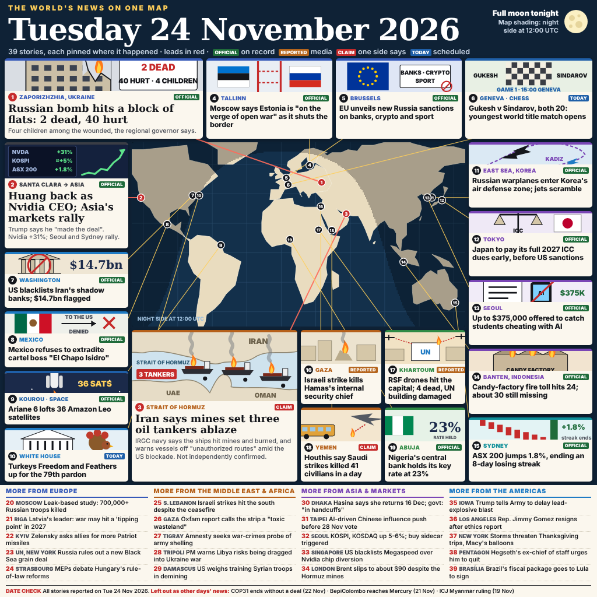

# The World on Tuesday, 24 November 2026

[](https://make.fun/bounty/news-image-20261124)
[](https://make.fun/bounty/news-image-20261124)
[](https://make.fun/bounty/news-image-20261124)

One image that sums up the world's news of Tuesday 24 November 2026 as an
annotated world map: the map sits in the middle with the night side shaded as
it stood at 12:00 UTC, and 19 illustrated story cards ring it, each tied by a
line to a numbered pin where the story happened (Europe across the top, the
Americas down the left, Asia and Oceania down the right, the Middle East and
Africa underneath; the three lead stories in red). A band below adds 20 more
stories by region, and a date check names what was left out as other days'
news. Every card says how sure it is: OFFICIAL, REPORTED, CLAIM or TODAY.
Entry for the
[news-image-20261124 bounty on make.fun](https://make.fun/bounty/news-image-20261124).



## The day's stories (39)

Leads: Iran's Guards say mines set three oil tankers ablaze in the Strait of
Hormuz · Jensen Huang back as Nvidia CEO; Nvidia +31%, KOSPI about +5% with a
buy sidecar, ASX ends an 8-day slide · Russian bomb hits a block of flats in
Zaporizhzhia: 2 dead, 40 hurt.

Cards: Moscow says Estonia is "on the verge of open war" · EU's new Russia
sanctions · US sanctions Iran's shadow banks ($14.7bn flagged) · Israeli
strike kills Hamas's internal security chief · RSF drones hit Khartoum and a
UN building · Houthis say Saudi strikes killed 41 civilians · Mexico refuses
to extradite "El Chapo Isidro" · Banten candy-factory fire toll 24 · Russian
warplanes in South Korea's air defense zone · Japan pays full 2027 ICC dues
early · Ariane 6 lofts 36 Amazon Leo satellites · Gukesh v Sindarov world
chess title match opens in Geneva.

Also: Nigeria holds rates at 23%; Seoul's AI-cheating rewards; Amnesty on
Tigray; Hasina's planned return; strikes in south Lebanon; Latvia's president
on the war; a leak-based estimate of 700,000+ Russian dead; Oxfam on Gaza;
Libya's PM; US demining training for Syria; a Chinese influence campaign
before Taiwan's vote; MEPs on Hungary; Brent near $90; ASX +1.8%; Brazil's
fiscal package; the Iowa detonation delay; Rep. Gomez resigns; Thanksgiving
storms; the turkey pardon; KOSPI and KOSDAQ; Megaspeed blacklisted;
Zelensky's Patriot appeal; no new Black Sea grain deal; Hegseth's ex-chief of
staff.

Sources: Reuters, AP, BBC, AFP, Anadolu, Yonhap, Arianespace, FIDE and the
Central Bank of Nigeria, through their reports and the daily roundups of
24 November 2026.

## How it is made

- `poster/frontpage.html` is the front page, laid out in HTML/CSS with every
  illustration drawn as inline SVG (no photos, no generated pixels), so all
  text is real type and stays sharp.
- `poster/render.mjs` renders it with Playwright/Chromium to `entry.png`
  (1024×1024 PNG) and fails if any text overflows the canvas.
- `main.ts` (Node 22, standard library only) checks the PNG against the
  bounty's gate and writes it to `/output/entry.png`; no network, identical
  bytes on every run.

```sh
node poster/render.mjs                         # rebuild entry.png (needs Playwright)
mkdir -p out && MAKEFUN_OUTPUT_DIR=out node main.ts
```

## License

MIT — see `LICENSE`.
